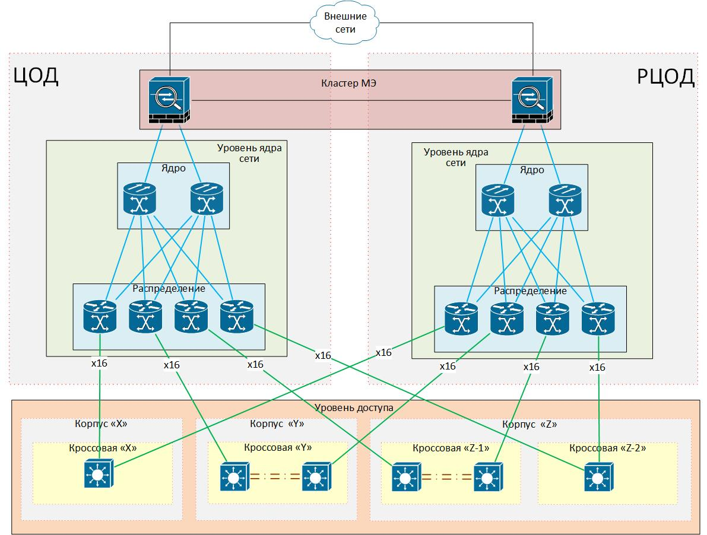
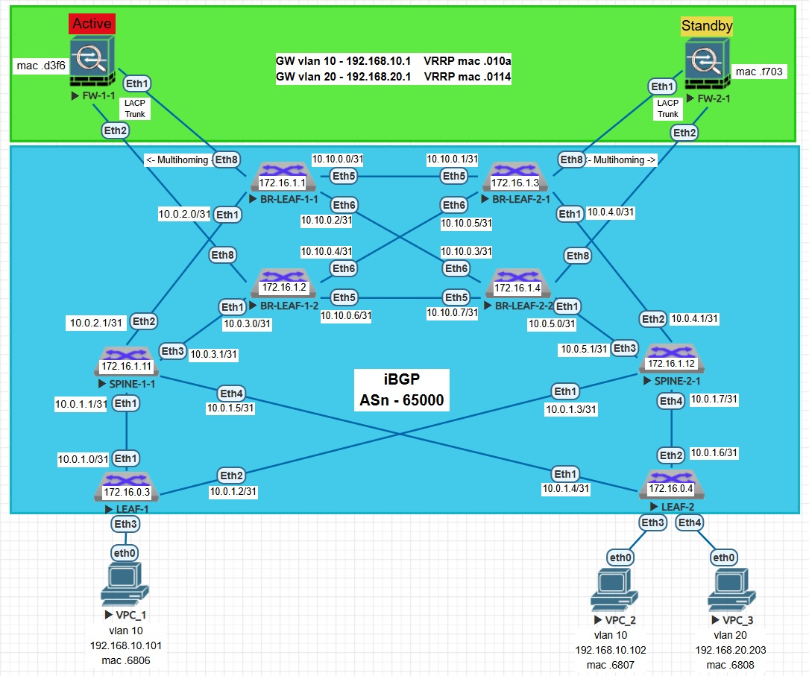

### Проектная работа - "Применение VxLAN EVPN в кампусной сети доступа предприятия"

### Задание
- Развернуть стенд сети доступа с применением VxLAN EVPN для заданной структуры (схемы):


#### Дополнительные требования
- В качестве внутреннего протокола маршрутизации Underlay-сети использовать iBGP.
- Использовать минимальное кол-во соединение между ЦОД и РЦОД.
- Добиться максимальной изоляции, подлкючаемых хостов (клиентов).

### Схема стенда


### Описание
На стенде используется минимальное кол-во узлов для имитации работы заданной сети.
#### LEAF
- Не являются клиентами RR SPINE. Получают маршруты LOOPBACK только от BORDER LEAF. Связность между LEAF на уровне Underlay-сети отсутствует, что соответствует требованию максимальной изоляции клиентов.
- Имеют основной и резервный маршруты (через другой ЦОД) до каждого BORDER LEAF на случай выхода из строя одного из SPINE, к которым они подключены.
#### BORDER LEAF
- Добавлены дополнительные линки для обеспечения связности между ЦОД и РЦОД.
- Являются RR для BORDER LEAF в противоположном ЦОД-е.
- На каждой паре настроен EVPN ETHERNET-SEGMENT для подключения FW агрегированным L2-каналом (LACP).
- Добавлены дополнительные правила фильтрации маршрутной информации ("костыли") для избегания петель и стабильной работы сети.
#### SPINE
- Участвуют только в L3-взаимодествии Underlay-сети (only bgp address-family ipv4) .
- Являются RR для BORDER LEAF.
#### FW
- Подключаются к паре BORDER LEAF в каждом ЦОД агрегированным L2-каналом (LACP). Между BORDER LEAF в одном ЦОД настроен MuLtihoming.
- Настроены VRRP-группы для шлюзов каждой сети (VLAN 10, VLAN 20). Схема работы: Active-Standby.
- Включена маршрутизация между VLAN 10 и VLAN 20.

### Настройки
<details>
<summary> LEAF-1 </summary>

```
!
service routing protocols model multi-agent
!
hostname LEAF-1
!
vlan 10
!
interface Ethernet1
   description SPINE-1-1
   mtu 9000
   no switchport
   ip address 10.0.1.0/31
!
interface Ethernet2
   description SPINE-2-1
   mtu 9000
   no switchport
   ip address 10.0.1.2/31
!
interface Ethernet3
   switchport access vlan 10
   spanning-tree portfast
!
!
interface Loopback0
   description Router-ID
   ip address 172.16.0.3/32
!
interface Vxlan1
   vxlan source-interface Loopback0
   vxlan udp-port 4789
   vxlan vlan 10 vni 10010
!
ip routing
!
route-map REDISTRIBUTE_ONLY_LOOPBACKS permit 10
   match interface Loopback0
!
router bgp 65000
   router-id 172.16.0.3
   no bgp default ipv4-unicast
   timers bgp 1 3
   maximum-paths 2 ecmp 2
   neighbor BORDER_LEAF_OVERLAY peer group
   neighbor BORDER_LEAF_OVERLAY remote-as 65000
   neighbor BORDER_LEAF_OVERLAY update-source Loopback0
   neighbor BORDER_LEAF_OVERLAY send-community extended
   neighbor SPINE peer group
   neighbor SPINE remote-as 65000
   neighbor 10.0.1.1 peer group SPINE
   neighbor 10.0.1.3 peer group SPINE
   neighbor 172.16.1.1 peer group BORDER_LEAF_OVERLAY
   neighbor 172.16.1.2 peer group BORDER_LEAF_OVERLAY
   neighbor 172.16.1.3 peer group BORDER_LEAF_OVERLAY
   neighbor 172.16.1.4 peer group BORDER_LEAF_OVERLAY
   !
   vlan 10
      rd 172.16.0.3:10
      route-target both 65000:10010
      redistribute learned
   !
   address-family evpn
      neighbor BORDER_LEAF_OVERLAY activate
   !
   address-family ipv4
      neighbor SPINE activate
      redistribute connected route-map REDISTRIBUTE_ONLY_LOOPBACKS
!
end
```
</details>
<details>
<summary> LEAF-2 </summary>

```
!
service routing protocols model multi-agent
!
hostname LEAF-2
!
vlan 10,20
!
interface Ethernet1
   description SPINE-1-1
   mtu 9000
   no switchport
   ip address 10.0.1.4/31
!
interface Ethernet2
   description SPINE-2-1
   mtu 9000
   no switchport
   ip address 10.0.1.6/31
!
interface Ethernet3
   switchport access vlan 10
   spanning-tree portfast
!
interface Ethernet4
   switchport access vlan 20
   spanning-tree portfast
!
interface Loopback0
   description Router-ID
   ip address 172.16.0.4/32
!
interface Vxlan1
   vxlan source-interface Loopback0
   vxlan udp-port 4789
   vxlan vlan 10 vni 10010
   vxlan vlan 20 vni 10020
!
ip routing
!
route-map REDISTRIBUTE_ONLY_LOOPBACKS permit 10
   match interface Loopback0
!
router bgp 65000
   router-id 172.16.0.4
   no bgp default ipv4-unicast
   timers bgp 1 3
   maximum-paths 2 ecmp 2
   neighbor BORDER_LEAF_OVERLAY peer group
   neighbor BORDER_LEAF_OVERLAY remote-as 65000
   neighbor BORDER_LEAF_OVERLAY update-source Loopback0
   neighbor BORDER_LEAF_OVERLAY send-community extended
   neighbor SPINE peer group
   neighbor SPINE remote-as 65000
   neighbor 10.0.1.5 peer group SPINE
   neighbor 10.0.1.7 peer group SPINE
   neighbor 172.16.1.1 peer group BORDER_LEAF_OVERLAY
   neighbor 172.16.1.2 peer group BORDER_LEAF_OVERLAY
   neighbor 172.16.1.3 peer group BORDER_LEAF_OVERLAY
   neighbor 172.16.1.4 peer group BORDER_LEAF_OVERLAY
   !
   vlan 10
      rd 172.16.0.4:10
      route-target both 65000:10010
      redistribute learned
   !
   vlan 20
      rd 172.16.0.4:20
      route-target both 65000:10020
      redistribute learned
   !
   address-family evpn
      neighbor BORDER_LEAF_OVERLAY activate
   !
   address-family ipv4
      neighbor SPINE activate
      redistribute connected route-map REDISTRIBUTE_ONLY_LOOPBACKS
!
end
```
</details>
<details>
<summary> BORDER-LEAF-1-1 </summary>

```
!
service routing protocols model multi-agent
!
hostname BORDER-LEAF-1-1
!
vlan 10,20
!
interface Port-Channel1
   description TO_Router
   switchport mode trunk
   !
   evpn ethernet-segment
      identifier 0000:0000:0000:0000:0001
      designated-forwarder election algorithm preference 20
      route-target import 00:00:00:00:00:01
   lacp system-id 1111.2222.3333
!
interface Ethernet1
   description to-Spine-1
   mtu 9000
   no switchport
   ip address 10.0.2.0/31
!
interface Ethernet5
   description BORDER_LEAF_2_1
   mtu 9000
   no switchport
   ip address 10.10.0.0/31
!
interface Ethernet6
   description BORDER_LEAF_2_2
   mtu 9000
   no switchport
   ip address 10.10.0.2/31
!
interface Ethernet8
   description TO_Router
   switchport mode trunk
   channel-group 1 mode active
!
interface Loopback0
   description Router-ID
   ip address 172.16.1.1/32
!
interface Vxlan1
   vxlan source-interface Loopback0
   vxlan udp-port 4789
   vxlan vlan 10 vni 10010
   vxlan vlan 20 vni 10020
!
ip routing
!
route-map LEAF_+_LOOPBACKS permit 10
   description LOCAL_LOOPBACK
   match interface Loopback0
!
route-map LEAF_+_LOOPBACKS permit 100
   description LEAFs_LOOPBACKs
   match local-preference 100
!
route-map NO_LP_50 deny 50
   match local-preference 50
!
route-map NO_LP_50 permit 100
!
route-map REDISTRIBUTE_ONLY_LOOPBACKS permit 10
   match interface Loopback0
!
route-map SET_LP_50 permit 50
   set local-preference 50
!
route-map SET_LP_75_LOOPBACK permit 75
   match interface Loopback0
   set local-preference 75
!
route-map SET_LP_75_LOOPBACK permit 100
!
router bgp 65000
   router-id 172.16.1.1
   no bgp default ipv4-unicast
   timers bgp 1 3
   maximum-paths 4 ecmp 4
   bgp listen range 172.16.0.0/24 peer-group LEAF_OVERLAY remote-as 65000
   neighbor BORDER_LEAF_DC_2 peer group
   neighbor BORDER_LEAF_DC_2 remote-as 65000
   neighbor BORDER_LEAF_DC_2 next-hop-self
   neighbor BORDER_LEAF_DC_2 route-reflector-client
   neighbor BORDER_LEAF_OVERLAY peer group
   neighbor BORDER_LEAF_OVERLAY remote-as 65000
   neighbor BORDER_LEAF_OVERLAY update-source Loopback0
   neighbor BORDER_LEAF_OVERLAY send-community extended
   neighbor LEAF_OVERLAY peer group
   neighbor LEAF_OVERLAY remote-as 65000
   neighbor LEAF_OVERLAY update-source Loopback0
   neighbor LEAF_OVERLAY send-community extended
   neighbor SPINE peer group
   neighbor SPINE remote-as 65000
   neighbor SPINE next-hop-self
   neighbor 10.0.2.1 peer group SPINE
   neighbor 10.10.0.1 peer group BORDER_LEAF_DC_2
   neighbor 10.10.0.3 peer group BORDER_LEAF_DC_2
   neighbor 172.16.1.2 peer group BORDER_LEAF_OVERLAY
   neighbor 172.16.1.3 peer group BORDER_LEAF_OVERLAY
   neighbor 172.16.1.4 peer group BORDER_LEAF_OVERLAY
   !
   vlan 10
      rd 172.16.1.1:10
      route-target both 65000:10010
      redistribute learned
   !
   vlan 20
      rd 172.16.1.1:20
      route-target both 65000:10020
      redistribute learned
   !
   address-family evpn
      neighbor BORDER_LEAF_OVERLAY activate
      neighbor LEAF_OVERLAY activate
   !
   address-family ipv4
      neighbor BORDER_LEAF_DC_2 activate
      neighbor BORDER_LEAF_DC_2 route-map SET_LP_50 in
      neighbor BORDER_LEAF_DC_2 route-map LEAF_+_LOOPBACKS out
      neighbor SPINE activate
      neighbor SPINE route-map NO_LP_50 in
      neighbor SPINE route-map SET_LP_75_LOOPBACK out
      redistribute connected route-map REDISTRIBUTE_ONLY_LOOPBACKS
!
end
```
</details>

<details>
<summary> BORDER-LEAF-1-2 </summary>

```
!
service routing protocols model multi-agent
!
hostname BORDER-LEAF-1-2
!
vlan 10,20
!
interface Port-Channel1
   description TO_Router
   switchport mode trunk
   !
   evpn ethernet-segment
      identifier 0000:0000:0000:0000:0001
      designated-forwarder election algorithm preference 50
      route-target import 00:00:00:00:00:01
   lacp system-id 1111.2222.3333
!
interface Ethernet1
   description to-Spine-1
   mtu 9000
   no switchport
   ip address 10.0.3.0/31
!
!
interface Ethernet5
   description BORDER-LEAF-2-2
   mtu 9000
   no switchport
   ip address 10.10.0.6/31
!
interface Ethernet6
   description BORDER-LEAF-2-1
   mtu 9000
   no switchport
   ip address 10.10.0.4/31
!
interface Ethernet8
   switchport mode trunk
   channel-group 1 mode active
!
interface Loopback0
   description Router-ID
   ip address 172.16.1.2/32
!
interface Vxlan1
   vxlan source-interface Loopback0
   vxlan udp-port 4789
   vxlan vlan 10 vni 10010
   vxlan vlan 20 vni 10020
!
ip routing
!
route-map LEAF_+_LOOPBACKS permit 10
   description LOCAL_LOOPBACK
   match interface Loopback0
!
route-map LEAF_+_LOOPBACKS permit 100
   description LEAFs_LOOPBACKs
   match local-preference 100
!
route-map NO_LP_50 deny 50
   match local-preference 50
!
route-map NO_LP_50 permit 100
!
route-map REDISTRIBUTE_ONLY_LOOPBACKS permit 10
   match interface Loopback0
!
route-map SET_LP_50 permit 50
   set local-preference 50
!
route-map SET_LP_75_LOOPBACK permit 75
   match interface Loopback0
   set local-preference 75
!
route-map SET_LP_75_LOOPBACK permit 100
!
router bgp 65000
   router-id 172.16.1.2
   no bgp default ipv4-unicast
   timers bgp 1 3
   maximum-paths 4 ecmp 4
   bgp listen range 172.16.0.0/24 peer-group LEAF_OVERLAY remote-as 65000
   neighbor BORDER_LEAF_2 peer group
   neighbor BORDER_LEAF_DC_2 peer group
   neighbor BORDER_LEAF_DC_2 remote-as 65000
   neighbor BORDER_LEAF_DC_2 next-hop-self
   neighbor BORDER_LEAF_DC_2 route-reflector-client
   neighbor BORDER_LEAF_OVERLAY peer group
   neighbor BORDER_LEAF_OVERLAY remote-as 65000
   neighbor BORDER_LEAF_OVERLAY update-source Loopback0
   neighbor BORDER_LEAF_OVERLAY send-community extended
   neighbor LEAF_OVERLAY peer group
   neighbor LEAF_OVERLAY remote-as 65000
   neighbor LEAF_OVERLAY update-source Loopback0
   neighbor LEAF_OVERLAY send-community extended
   neighbor SPINE peer group
   neighbor SPINE remote-as 65000
   neighbor SPINE next-hop-self
   neighbor 10.0.3.1 peer group SPINE
   neighbor 10.10.0.5 peer group BORDER_LEAF_DC_2
   neighbor 10.10.0.7 peer group BORDER_LEAF_DC_2
   neighbor 172.16.1.1 peer group BORDER_LEAF_OVERLAY
   neighbor 172.16.1.3 peer group BORDER_LEAF_OVERLAY
   neighbor 172.16.1.4 peer group BORDER_LEAF_OVERLAY
   !
   vlan 10
      rd 172.16.1.2:10
      route-target both 65000:10010
      redistribute learned
   !
   vlan 20
      rd 172.16.1.2:20
      route-target both 65000:10020
      redistribute learned
   !
   address-family evpn
      neighbor BORDER_LEAF_OVERLAY activate
      neighbor LEAF_OVERLAY activate
   !
   address-family ipv4
      neighbor BORDER_LEAF_DC_2 activate
      neighbor BORDER_LEAF_DC_2 route-map SET_LP_50 in
      neighbor BORDER_LEAF_DC_2 route-map LEAF_+_LOOPBACKS out
      neighbor SPINE activate
      neighbor SPINE route-map NO_LP_50 in
      neighbor SPINE route-map SET_LP_75_LOOPBACK out
      redistribute connected route-map REDISTRIBUTE_ONLY_LOOPBACKS
!
end
```
</details>

<details>
<summary> BORDER-LEAF-2-1 </summary>

```
!
service routing protocols model multi-agent
!
hostname BORDER-LEAF-2-1
!
vlan 10,20
!
interface Port-Channel1
   description FW-2-1
   switchport mode trunk
   !
   evpn ethernet-segment
      identifier 0000:0000:0000:0000:0002
      designated-forwarder election algorithm preference 20
      route-target import 00:00:00:00:00:02
   lacp system-id 1111.4444.5555
!
interface Ethernet1
   description SPINE-2-1
   mtu 9000
   no switchport
   ip address 10.0.4.0/31
!
!
interface Ethernet5
   description BORDER-LEAF-1-1
   mtu 9000
   no switchport
   ip address 10.10.0.1/31
!
interface Ethernet6
   description BORDER-LEAF-1-2
   mtu 9000
   no switchport
   ip address 10.10.0.5/31
!
interface Ethernet8
   description FW-2-1
   switchport mode trunk
   channel-group 1 mode active
!
interface Loopback0
   description Router-ID
   ip address 172.16.1.3/32
!
interface Vxlan1
   vxlan source-interface Loopback0
   vxlan udp-port 4789
   vxlan vlan 10 vni 10010
   vxlan vlan 20 vni 10020
!
ip routing
!
route-map LEAF_+_LOOPBACKS permit 10
   description LOCAL_LOOPBACK
   match interface Loopback0
!
route-map LEAF_+_LOOPBACKS permit 100
   description LEAFs_LOOPBACKS
   match local-preference 100
!
route-map NO_LP_50 deny 50
   match local-preference 50
!
route-map NO_LP_50 permit 100
!
route-map REDISTRIBUTE_ONLY_LOOPBACKS permit 10
   match interface Loopback0
!
route-map SET_LP_50 permit 50
   set local-preference 50
!
route-map SET_LP_75_LOOPBACK permit 75
   match interface Loopback0
   set local-preference 75
!
route-map SET_LP_75_LOOPBACK permit 100
!
router bgp 65000
   router-id 172.16.1.3
   no bgp default ipv4-unicast
   timers bgp 1 3
   maximum-paths 4 ecmp 4
   bgp listen range 172.16.0.0/24 peer-group LEAF_OVERLAY remote-as 65000
   neighbor BORDER_LEAF_DC_1 peer group
   neighbor BORDER_LEAF_DC_1 remote-as 65000
   neighbor BORDER_LEAF_DC_1 next-hop-self
   neighbor BORDER_LEAF_DC_1 route-reflector-client
   neighbor BORDER_LEAF_OVERLAY peer group
   neighbor BORDER_LEAF_OVERLAY remote-as 65000
   neighbor BORDER_LEAF_OVERLAY update-source Loopback0
   neighbor BORDER_LEAF_OVERLAY send-community extended
   neighbor LEAF_OVERLAY peer group
   neighbor LEAF_OVERLAY remote-as 65000
   neighbor LEAF_OVERLAY update-source Loopback0
   neighbor LEAF_OVERLAY send-community extended
   neighbor SPINE peer group
   neighbor SPINE remote-as 65000
   neighbor SPINE next-hop-self
   neighbor 10.0.4.1 peer group SPINE
   neighbor 10.10.0.0 peer group BORDER_LEAF_DC_1
   neighbor 10.10.0.4 peer group BORDER_LEAF_DC_1
   neighbor 172.16.1.1 peer group BORDER_LEAF_OVERLAY
   neighbor 172.16.1.2 peer group BORDER_LEAF_OVERLAY
   neighbor 172.16.1.4 peer group BORDER_LEAF_OVERLAY
   !
   vlan 10
      rd 172.16.1.3:10
      route-target both 65000:10010
      redistribute learned
   !
   vlan 20
      rd 172.16.1.3:20
      route-target both 65000:10020
      redistribute learned
   !
   address-family evpn
      neighbor BORDER_LEAF_OVERLAY activate
      neighbor LEAF_OVERLAY activate
   !
   address-family ipv4
      neighbor BORDER_LEAF_DC_1 activate
      neighbor BORDER_LEAF_DC_1 route-map SET_LP_50 in
      neighbor BORDER_LEAF_DC_1 route-map LEAF_+_LOOPBACKS out
      neighbor SPINE activate
      neighbor SPINE route-map NO_LP_50 in
      neighbor SPINE route-map SET_LP_75_LOOPBACK out
      redistribute connected route-map REDISTRIBUTE_ONLY_LOOPBACKS
!
end
```
</details>

<details>
<summary> BORDER-LEAF-2-2 </summary>

```
!
service routing protocols model multi-agent
!
hostname BORDER-LEAF-2-2
!
vlan 10,20
!
interface Port-Channel1
   description FW-2-1
   switchport mode trunk
   !
   evpn ethernet-segment
      identifier 0000:0000:0000:0000:0002
      designated-forwarder election algorithm preference 50
      route-target import 00:00:00:00:00:02
   lacp system-id 1111.4444.5555
!
interface Ethernet1
   description SPINE-2-1
   mtu 9000
   no switchport
   ip address 10.0.5.0/31
!
interface Ethernet5
   description BORDER-LEAF-1-2
   mtu 9000
   no switchport
   ip address 10.10.0.7/31
!
interface Ethernet6
   description BORDER-LEAF-1-1
   mtu 9000
   no switchport
   ip address 10.10.0.3/31
!
interface Ethernet8
   description FW-2-1
   switchport mode trunk
   channel-group 1 mode active
!
interface Loopback0
   description Router-ID
   ip address 172.16.1.4/32
!
interface Vxlan1
   vxlan source-interface Loopback0
   vxlan udp-port 4789
   vxlan vlan 10 vni 10010
   vxlan vlan 20 vni 10020
!
ip routing
!
route-map LEAF_+_LOOPBACKS permit 10
   description LOCAL_LOOPBACK
   match interface Loopback0
!
route-map LEAF_+_LOOPBACKS permit 100
   description LEAFs_LOOPBACKS
   match local-preference 100
!
route-map NO_LP_50 deny 50
   match local-preference 50
!
route-map NO_LP_50 permit 100
!
route-map REDISTRIBUTE_ONLY_LOOPBACKS permit 10
   match interface Loopback0
!
route-map SET_LP_50 permit 50
   set local-preference 50
!
route-map SET_LP_75_LOOPBACK permit 75
   match interface Loopback0
   set local-preference 75
!
route-map SET_LP_75_LOOPBACK permit 100
!
router bgp 65000
   router-id 172.16.1.4
   no bgp default ipv4-unicast
   timers bgp 1 3
   maximum-paths 4 ecmp 4
   bgp listen range 172.16.0.0/24 peer-group LEAF_OVERLAY remote-as 65000
   neighbor BORDER_LEAF_DC_1 peer group
   neighbor BORDER_LEAF_DC_1 remote-as 65000
   neighbor BORDER_LEAF_DC_1 next-hop-self
   neighbor BORDER_LEAF_DC_1 route-reflector-client
   neighbor BORDER_LEAF_OVERLAY peer group
   neighbor BORDER_LEAF_OVERLAY remote-as 65000
   neighbor BORDER_LEAF_OVERLAY update-source Loopback0
   neighbor BORDER_LEAF_OVERLAY send-community extended
   neighbor LEAF_OVERLAY peer group
   neighbor LEAF_OVERLAY remote-as 65000
   neighbor LEAF_OVERLAY update-source Loopback0
   neighbor LEAF_OVERLAY send-community extended
   neighbor SPINE peer group
   neighbor SPINE remote-as 65000
   neighbor SPINE next-hop-self
   neighbor 10.0.5.1 peer group SPINE
   neighbor 10.10.0.2 peer group BORDER_LEAF_DC_1
   neighbor 10.10.0.6 peer group BORDER_LEAF_DC_1
   neighbor 172.16.1.1 peer group BORDER_LEAF_OVERLAY
   neighbor 172.16.1.2 peer group BORDER_LEAF_OVERLAY
   neighbor 172.16.1.3 peer group BORDER_LEAF_OVERLAY
   !
   vlan 10
      rd 172.16.1.4:10
      route-target both 65000:10010
      redistribute learned
   !
   vlan 20
      rd 172.16.1.4:20
      route-target both 65000:10020
      redistribute learned
   !
   address-family evpn
      neighbor BORDER_LEAF_OVERLAY activate
      neighbor LEAF_OVERLAY activate
   !
   address-family ipv4
      neighbor BORDER_LEAF_DC_1 activate
      neighbor BORDER_LEAF_DC_1 route-map SET_LP_50 in
      neighbor BORDER_LEAF_DC_1 route-map LEAF_+_LOOPBACKS out
      neighbor SPINE activate
      neighbor SPINE route-map NO_LP_50 in
      neighbor SPINE route-map SET_LP_75_LOOPBACK out
      redistribute connected route-map REDISTRIBUTE_ONLY_LOOPBACKS
!
end
```
</details>

<details>
<summary> SPINE-1-1 </summary>

```
!
service routing protocols model multi-agent
!
hostname SPINE-1-1
!
interface Ethernet1
   description LEAF-1
   mtu 9000
   no switchport
   ip address 10.0.1.1/31
!
interface Ethernet2
   description BORDER-LEAF-1-1
   mtu 9000
   no switchport
   ip address 10.0.2.1/31
!
interface Ethernet3
   description BORDER-LEAF-1-2
   mtu 9000
   no switchport
   ip address 10.0.3.1/31
!
interface Ethernet4
   description LEAF-2
   mtu 9000
   no switchport
   ip address 10.0.1.5/31
!
interface Loopback0
   description Router-ID
   ip address 172.16.1.11/32
!
ip routing
!
router bgp 65000
   router-id 172.16.1.11
   no bgp default ipv4-unicast
   timers bgp 1 3
   maximum-paths 2 ecmp 2
   bgp listen range 10.0.0.0/16 peer-group LEAF remote-as 65000
   neighbor BORDER_LEAF peer group
   neighbor BORDER_LEAF remote-as 65000
   neighbor BORDER_LEAF next-hop-self
   neighbor BORDER_LEAF route-reflector-client
   neighbor LEAF peer group
   neighbor LEAF remote-as 65000
   neighbor LEAF next-hop-self
   neighbor 10.0.2.0 peer group BORDER_LEAF
   neighbor 10.0.3.0 peer group BORDER_LEAF
   !
   address-family ipv4
      neighbor BORDER_LEAF activate
      neighbor LEAF activate
!
end
```
</details>

<details>
<summary> SPINE-2-1 </summary>

```
!
service routing protocols model multi-agent
!
hostname SPINE-2-1
!
interface Ethernet1
   description LEAF-1
   mtu 9000
   no switchport
   ip address 10.0.1.3/31
!
interface Ethernet2
   description BORDER-LEAF-2-1
   mtu 9000
   no switchport
   ip address 10.0.4.1/31
!
interface Ethernet3
   description BORDER-LEAF-2-2
   mtu 9000
   no switchport
   ip address 10.0.5.1/31
!
interface Ethernet4
   description LEAF-2
   mtu 9000
   no switchport
   ip address 10.0.1.7/31
!
interface Loopback0
   description Router-ID
   ip address 172.16.1.12/32
!
ip routing
!
router bgp 65000
   router-id 172.16.1.12
   no bgp default ipv4-unicast
   timers bgp 1 3
   maximum-paths 2 ecmp 2
   bgp listen range 10.0.0.0/16 peer-group LEAF remote-as 65000
   neighbor BORDER_LEAF peer group
   neighbor BORDER_LEAF remote-as 65000
   neighbor BORDER_LEAF next-hop-self
   neighbor BORDER_LEAF route-reflector-client
   neighbor LEAF peer group
   neighbor LEAF remote-as 65000
   neighbor LEAF next-hop-self
   neighbor 10.0.4.0 peer group BORDER_LEAF
   neighbor 10.0.5.0 peer group BORDER_LEAF
   !
   address-family ipv4
      neighbor BORDER_LEAF activate
      neighbor LEAF activate
!
end
```
</details>

<details>
<summary> FW-1-1 </summary>

```
!
hostname FW-1-1
!
vlan 10,20
!
interface Port-Channel1
   description TO_LEAF2_&_LEAF3
   switchport mode trunk
!
interface Ethernet1
   switchport mode trunk
   channel-group 1 mode active
!
interface Ethernet2
   switchport mode trunk
   channel-group 1 mode active
!
interface Loopback0
   ip address 8.8.8.8/32
!
interface Vlan10
   no autostate
   ip address 192.168.10.2/24
   vrrp 10 priority-level 150
   no vrrp 10 peer authentication
   vrrp 10 ipv4 192.168.10.1
!
interface Vlan20
   no autostate
   ip address 192.168.20.2/24
   vrrp 20 priority-level 150
   no vrrp 20 peer authentication
   vrrp 20 ipv4 192.168.20.1
!
ip routing
!
ip route 0.0.0.0/0 Null0
!
end
```
</details>

<details>
<summary> FW-2-1 </summary>

```
!
hostname FW-2-1
!
vlan 10,20
!
interface Port-Channel1
   switchport mode trunk
!
interface Ethernet1
   switchport mode trunk
   channel-group 1 mode active
!
interface Ethernet2
   switchport mode trunk
   channel-group 1 mode active
!
interface Loopback0
   ip address 8.8.8.8/32
!
interface Vlan10
   no autostate
   ip address 192.168.10.3/24
   no vrrp 10 peer authentication
   vrrp 10 ipv4 192.168.10.1
!
interface Vlan20
   no autostate
   ip address 192.168.20.3/24
   no vrrp 20 peer authentication
   vrrp 20 ipv4 192.168.20.1
!
ip routing
!
ip route 0.0.0.0/0 Null0
!
end
```
</details>

### Проверка работы
#### Проверка работы Underlay-сети (iBGP)
<details>
<summary> BORDER-LEAF-1-1 </summary>

```
BORDER-LEAF-1-1#show ip route bgp 


 B I      172.16.0.3/32 [200/0] via 10.0.2.1, Ethernet1
 B I      172.16.0.4/32 [200/0] via 10.0.2.1, Ethernet1
 B I      172.16.1.2/32 [200/0] via 10.0.2.1, Ethernet1
 B I      172.16.1.3/32 [200/0] via 10.10.0.1, Ethernet5
 B I      172.16.1.4/32 [200/0] via 10.10.0.3, Ethernet6

BORDER-LEAF-1-1#show ip bgp neighbors received-routes 


          Network                Peer              Next Hop              Metric  AIGP       LocPref Weight  Path
          10.0.2.0/31            -                 -                     -       -          -       -       i
          10.10.0.0/31           -                 -                     -       -          -       -       i
          10.10.0.2/31           -                 -                     -       -          -       -       i
 * >      172.16.0.3/32          10.0.2.1          10.0.2.1              -       -          100     -       i Or-ID: 172.16.0.3 C-LST: 172.16.1.11 
 *        172.16.0.3/32          10.10.0.1         10.10.0.1             -       -          100     -       i Or-ID: 172.16.0.3 C-LST: 172.16.1.3 172.16.1.12 
 *        172.16.0.3/32          10.10.0.3         10.10.0.3             -       -          100     -       i Or-ID: 172.16.0.3 C-LST: 172.16.1.4 172.16.1.12 
 * >      172.16.0.4/32          10.0.2.1          10.0.2.1              -       -          100     -       i Or-ID: 172.16.0.4 C-LST: 172.16.1.11 
 *        172.16.0.4/32          10.10.0.1         10.10.0.1             -       -          100     -       i Or-ID: 172.16.0.4 C-LST: 172.16.1.3 172.16.1.12 
 *        172.16.0.4/32          10.10.0.3         10.10.0.3             -       -          100     -       i Or-ID: 172.16.0.4 C-LST: 172.16.1.4 172.16.1.12 
 * >      172.16.1.1/32          -                 -                     -       -          -       -       i
 * >      172.16.1.2/32          10.0.2.1          10.0.2.1              -       -          75      -       i Or-ID: 172.16.1.2 C-LST: 172.16.1.11 
 * >      172.16.1.3/32          10.10.0.1         10.10.0.1             -       -          100     -       i
 * >      172.16.1.4/32          10.10.0.3         10.10.0.3             -       -          100     -       i


BORDER-LEAF-1-1#show bgp summary 
BGP summary information for VRF default
Router identifier 172.16.1.1, local AS number 65000
Neighbor            AS Session State AFI/SAFI                AFI/SAFI State   NLRI Rcd   NLRI Acc
---------- ----------- ------------- ----------------------- -------------- ---------- ----------
10.0.2.1         65000 Established   IPv4 Unicast            Negotiated              3          3
10.10.0.1        65000 Established   IPv4 Unicast            Negotiated              3          3
10.10.0.3        65000 Established   IPv4 Unicast            Negotiated              3          3
172.16.0.3       65000 Established   L2VPN EVPN              Negotiated              1          1
172.16.0.4       65000 Established   L2VPN EVPN              Negotiated              2          2
172.16.1.2       65000 Established   L2VPN EVPN              Negotiated              7          7
172.16.1.3       65000 Established   L2VPN EVPN              Negotiated              6          6
172.16.1.4       65000 Established   L2VPN EVPN              Negotiated              6          6
```
</details>
<details>
<summary> BORDER-LEAF-1-2 </summary>

```
BORDER-LEAF-1-2#show ip route bgp


 B I      172.16.0.3/32 [200/0] via 10.0.3.1, Ethernet1
 B I      172.16.0.4/32 [200/0] via 10.0.3.1, Ethernet1
 B I      172.16.1.1/32 [200/0] via 10.0.3.1, Ethernet1
 B I      172.16.1.3/32 [200/0] via 10.10.0.5, Ethernet6
 B I      172.16.1.4/32 [200/0] via 10.10.0.7, Ethernet5

BORDER-LEAF-1-2#show ip bgp neighbors received-routes 


          Network                Peer              Next Hop              Metric  AIGP       LocPref Weight  Path
          10.0.3.0/31            -                 -                     -       -          -       -       i
          10.10.0.4/31           -                 -                     -       -          -       -       i
          10.10.0.6/31           -                 -                     -       -          -       -       i
 * >      172.16.0.3/32          10.0.3.1          10.0.3.1              -       -          100     -       i Or-ID: 172.16.0.3 C-LST: 172.16.1.11 
 *        172.16.0.3/32          10.10.0.7         10.10.0.7             -       -          100     -       i Or-ID: 172.16.0.3 C-LST: 172.16.1.4 172.16.1.12 
 *        172.16.0.3/32          10.10.0.5         10.10.0.5             -       -          100     -       i Or-ID: 172.16.0.3 C-LST: 172.16.1.3 172.16.1.12 
 * >      172.16.0.4/32          10.0.3.1          10.0.3.1              -       -          100     -       i Or-ID: 172.16.0.4 C-LST: 172.16.1.11 
 *        172.16.0.4/32          10.10.0.7         10.10.0.7             -       -          100     -       i Or-ID: 172.16.0.4 C-LST: 172.16.1.4 172.16.1.12 
 *        172.16.0.4/32          10.10.0.5         10.10.0.5             -       -          100     -       i Or-ID: 172.16.0.4 C-LST: 172.16.1.3 172.16.1.12 
 * >      172.16.1.1/32          10.0.3.1          10.0.3.1              -       -          75      -       i Or-ID: 172.16.1.1 C-LST: 172.16.1.11 
 * >      172.16.1.2/32          -                 -                     -       -          -       -       i
 * >      172.16.1.3/32          10.10.0.5         10.10.0.5             -       -          100     -       i
          172.16.1.3/32          10.0.3.1          10.0.3.1              -       -          50      -       i Or-ID: 172.16.1.3 C-LST: 172.16.1.11 172.16.1.1 
 * >      172.16.1.4/32          10.10.0.7         10.10.0.7             -       -          100     -       i
          172.16.1.4/32          10.0.3.1          10.0.3.1              -       -          50      -       i Or-ID: 172.16.1.4 C-LST: 172.16.1.11 172.16.1.1 


BORDER-LEAF-1-2#show bgp summary 
BGP summary information for VRF default
Router identifier 172.16.1.2, local AS number 65000
Neighbor            AS Session State AFI/SAFI                AFI/SAFI State   NLRI Rcd   NLRI Acc
---------- ----------- ------------- ----------------------- -------------- ---------- ----------
10.0.3.1         65000 Established   IPv4 Unicast            Negotiated              5          3
10.10.0.5        65000 Established   IPv4 Unicast            Negotiated              3          3
10.10.0.7        65000 Established   IPv4 Unicast            Negotiated              3          3
172.16.0.3       65000 Established   L2VPN EVPN              Negotiated              1          1
172.16.0.4       65000 Established   L2VPN EVPN              Negotiated              2          2
172.16.1.1       65000 Established   L2VPN EVPN              Negotiated              7          7
172.16.1.3       65000 Established   L2VPN EVPN              Negotiated              6          6
172.16.1.4       65000 Established   L2VPN EVPN              Negotiated              6          6
```
</details>
<details>
<summary> BORDER-LEAF-2-1 </summary>

```
BORDER-LEAF-2-1#show ip route bgp 

 B I      172.16.0.3/32 [200/0] via 10.0.4.1, Ethernet1
 B I      172.16.0.4/32 [200/0] via 10.0.4.1, Ethernet1
 B I      172.16.1.1/32 [200/0] via 10.10.0.0, Ethernet5
 B I      172.16.1.2/32 [200/0] via 10.10.0.4, Ethernet6
 B I      172.16.1.4/32 [200/0] via 10.0.4.1, Ethernet1


BORDER-LEAF-2-1#show ip bgp neighbors received-routes 

          Network                Peer              Next Hop              Metric  AIGP       LocPref Weight  Path
          10.0.4.0/31            -                 -                     -       -          -       -       i
          10.10.0.0/31           -                 -                     -       -          -       -       i
          10.10.0.4/31           -                 -                     -       -          -       -       i
 * >      172.16.0.3/32          10.0.4.1          10.0.4.1              -       -          100     -       i Or-ID: 172.16.0.3 C-LST: 172.16.1.12 
 *        172.16.0.3/32          10.10.0.4         10.10.0.4             -       -          100     -       i Or-ID: 172.16.0.3 C-LST: 172.16.1.2 172.16.1.11 
 *        172.16.0.3/32          10.10.0.0         10.10.0.0             -       -          100     -       i Or-ID: 172.16.0.3 C-LST: 172.16.1.1 172.16.1.11 
 * >      172.16.0.4/32          10.0.4.1          10.0.4.1              -       -          100     -       i Or-ID: 172.16.0.4 C-LST: 172.16.1.12 
 *        172.16.0.4/32          10.10.0.4         10.10.0.4             -       -          100     -       i Or-ID: 172.16.0.4 C-LST: 172.16.1.2 172.16.1.11 
 *        172.16.0.4/32          10.10.0.0         10.10.0.0             -       -          100     -       i Or-ID: 172.16.0.4 C-LST: 172.16.1.1 172.16.1.11 
 * >      172.16.1.1/32          10.10.0.0         10.10.0.0             -       -          100     -       i
 * >      172.16.1.2/32          10.10.0.4         10.10.0.4             -       -          100     -       i
 * >      172.16.1.3/32          -                 -                     -       -          -       -       i
 * >      172.16.1.4/32          10.0.4.1          10.0.4.1              -       -          75      -       i Or-ID: 172.16.1.4 C-LST: 172.16.1.12 


BORDER-LEAF-2-1#show bgp summary 
BGP summary information for VRF default
Router identifier 172.16.1.3, local AS number 65000
Neighbor            AS Session State AFI/SAFI                AFI/SAFI State   NLRI Rcd   NLRI Acc
---------- ----------- ------------- ----------------------- -------------- ---------- ----------
10.0.4.1         65000 Established   IPv4 Unicast            Negotiated              3          3
10.10.0.0        65000 Established   IPv4 Unicast            Negotiated              3          3
10.10.0.4        65000 Established   IPv4 Unicast            Negotiated              3          3
172.16.0.3       65000 Established   L2VPN EVPN              Negotiated              1          1
172.16.0.4       65000 Established   L2VPN EVPN              Negotiated              2          2
172.16.1.1       65000 Established   L2VPN EVPN              Negotiated              7          7
172.16.1.2       65000 Established   L2VPN EVPN              Negotiated              7          7
172.16.1.4       65000 Established   L2VPN EVPN              Negotiated              6          6
```
</details>
<details>
<summary> BORDER-LEAF-2-2 </summary>

```
BORDER-LEAF-2-2#show ip route bgp 

 B I      172.16.0.3/32 [200/0] via 10.0.5.1, Ethernet1
 B I      172.16.0.4/32 [200/0] via 10.0.5.1, Ethernet1
 B I      172.16.1.1/32 [200/0] via 10.10.0.2, Ethernet6
 B I      172.16.1.2/32 [200/0] via 10.10.0.6, Ethernet5
 B I      172.16.1.3/32 [200/0] via 10.0.5.1, Ethernet1


BORDER-LEAF-2-2#show ip bgp neighbors received-routes 

          Network                Peer              Next Hop              Metric  AIGP       LocPref Weight  Path
          10.0.5.0/31            -                 -                     -       -          -       -       i
          10.10.0.2/31           -                 -                     -       -          -       -       i
          10.10.0.6/31           -                 -                     -       -          -       -       i
 * >      172.16.0.3/32          10.0.5.1          10.0.5.1              -       -          100     -       i Or-ID: 172.16.0.3 C-LST: 172.16.1.12 
 *        172.16.0.3/32          10.10.0.6         10.10.0.6             -       -          100     -       i Or-ID: 172.16.0.3 C-LST: 172.16.1.2 172.16.1.11 
 *        172.16.0.3/32          10.10.0.2         10.10.0.2             -       -          100     -       i Or-ID: 172.16.0.3 C-LST: 172.16.1.1 172.16.1.11 
 * >      172.16.0.4/32          10.0.5.1          10.0.5.1              -       -          100     -       i Or-ID: 172.16.0.4 C-LST: 172.16.1.12 
 *        172.16.0.4/32          10.10.0.6         10.10.0.6             -       -          100     -       i Or-ID: 172.16.0.4 C-LST: 172.16.1.2 172.16.1.11 
 *        172.16.0.4/32          10.10.0.2         10.10.0.2             -       -          100     -       i Or-ID: 172.16.0.4 C-LST: 172.16.1.1 172.16.1.11 
 * >      172.16.1.1/32          10.10.0.2         10.10.0.2             -       -          100     -       i
          172.16.1.1/32          10.0.5.1          10.0.5.1              -       -          50      -       i Or-ID: 172.16.1.1 C-LST: 172.16.1.12 172.16.1.3 
 * >      172.16.1.2/32          10.10.0.6         10.10.0.6             -       -          100     -       i
          172.16.1.2/32          10.0.5.1          10.0.5.1              -       -          50      -       i Or-ID: 172.16.1.2 C-LST: 172.16.1.12 172.16.1.3 
 * >      172.16.1.3/32          10.0.5.1          10.0.5.1              -       -          75      -       i Or-ID: 172.16.1.3 C-LST: 172.16.1.12 
 * >      172.16.1.4/32          -                 -                     -       -          -       -       i


BORDER-LEAF-2-2#show bgp summary 
BGP summary information for VRF default
Router identifier 172.16.1.4, local AS number 65000
Neighbor            AS Session State AFI/SAFI                AFI/SAFI State   NLRI Rcd   NLRI Acc
---------- ----------- ------------- ----------------------- -------------- ---------- ----------
10.0.5.1         65000 Established   IPv4 Unicast            Negotiated              5          3
10.10.0.2        65000 Established   IPv4 Unicast            Negotiated              3          3
10.10.0.6        65000 Established   IPv4 Unicast            Negotiated              3          3
172.16.0.3       65000 Established   L2VPN EVPN              Negotiated              1          1
172.16.0.4       65000 Established   L2VPN EVPN              Negotiated              2          2
172.16.1.1       65000 Established   L2VPN EVPN              Negotiated              7          7
172.16.1.2       65000 Established   L2VPN EVPN              Negotiated              7          7
172.16.1.3       65000 Established   L2VPN EVPN              Negotiated              6          6
```
</details>
<details>
<summary> SPINE-1-1 </summary>

```
SPINE-1-1#show ip route bgp 


 B I      172.16.0.3/32 [200/0] via 10.0.1.0, Ethernet1
 B I      172.16.0.4/32 [200/0] via 10.0.1.4, Ethernet4
 B I      172.16.1.1/32 [200/0] via 10.0.2.0, Ethernet2
 B I      172.16.1.2/32 [200/0] via 10.0.3.0, Ethernet3
 B I      172.16.1.3/32 [200/0] via 10.0.2.0, Ethernet2
                                via 10.0.3.0, Ethernet3
 B I      172.16.1.4/32 [200/0] via 10.0.2.0, Ethernet2
                                via 10.0.3.0, Ethernet3

SPINE-1-1#show ip bgp neighbors received-routes 

          Network                Peer              Next Hop              Metric  AIGP       LocPref Weight  Path
 * >      172.16.0.3/32          10.0.1.0          10.0.1.0              -       -          100     -       i
 * >      172.16.0.4/32          10.0.1.4          10.0.1.4              -       -          100     -       i
 * >      172.16.1.1/32          10.0.2.0          10.0.2.0              -       -          75      -       i
 * >      172.16.1.2/32          10.0.3.0          10.0.3.0              -       -          75      -       i
 * >Ec    172.16.1.3/32          10.0.2.0          10.0.2.0              -       -          50      -       i Or-ID: 172.16.1.3 C-LST: 172.16.1.1 
 *  ec    172.16.1.3/32          10.0.3.0          10.0.3.0              -       -          50      -       i Or-ID: 172.16.1.3 C-LST: 172.16.1.2 
 * >Ec    172.16.1.4/32          10.0.2.0          10.0.2.0              -       -          50      -       i Or-ID: 172.16.1.4 C-LST: 172.16.1.1 
 *  ec    172.16.1.4/32          10.0.3.0          10.0.3.0              -       -          50      -       i Or-ID: 172.16.1.4 C-LST: 172.16.1.2 


SPINE-1-1#show bgp summary 
BGP summary information for VRF default
Router identifier 172.16.1.11, local AS number 65000
Neighbor          AS Session State AFI/SAFI                AFI/SAFI State   NLRI Rcd   NLRI Acc
-------- ----------- ------------- ----------------------- -------------- ---------- ----------
10.0.1.0       65000 Established   IPv4 Unicast            Negotiated              1          1
10.0.1.4       65000 Established   IPv4 Unicast            Negotiated              1          1
10.0.2.0       65000 Established   IPv4 Unicast            Negotiated              3          3
10.0.3.0       65000 Established   IPv4 Unicast            Negotiated              3          3
```
</details>
<details>
<summary> SPINE-2-1 </summary>

```
SPINE-2-1#show ip route bgp 


 B I      172.16.0.3/32 [200/0] via 10.0.1.2, Ethernet1
 B I      172.16.0.4/32 [200/0] via 10.0.1.6, Ethernet4
 B I      172.16.1.1/32 [200/0] via 10.0.4.0, Ethernet2
                                via 10.0.5.0, Ethernet3
 B I      172.16.1.2/32 [200/0] via 10.0.4.0, Ethernet2
                                via 10.0.5.0, Ethernet3
 B I      172.16.1.3/32 [200/0] via 10.0.4.0, Ethernet2
 B I      172.16.1.4/32 [200/0] via 10.0.5.0, Ethernet3

SPINE-2-1#show ip bgp neighbors received-routes 


          Network                Peer              Next Hop              Metric  AIGP       LocPref Weight  Path
 * >      172.16.0.3/32          10.0.1.2          10.0.1.2              -       -          100     -       i
 * >      172.16.0.4/32          10.0.1.6          10.0.1.6              -       -          100     -       i
 * >Ec    172.16.1.1/32          10.0.4.0          10.0.4.0              -       -          50      -       i Or-ID: 172.16.1.1 C-LST: 172.16.1.3 
 *  ec    172.16.1.1/32          10.0.5.0          10.0.5.0              -       -          50      -       i Or-ID: 172.16.1.1 C-LST: 172.16.1.4 
 * >Ec    172.16.1.2/32          10.0.4.0          10.0.4.0              -       -          50      -       i Or-ID: 172.16.1.2 C-LST: 172.16.1.3 
 *  ec    172.16.1.2/32          10.0.5.0          10.0.5.0              -       -          50      -       i Or-ID: 172.16.1.2 C-LST: 172.16.1.4 
 * >      172.16.1.3/32          10.0.4.0          10.0.4.0              -       -          75      -       i
 * >      172.16.1.4/32          10.0.5.0          10.0.5.0              -       -          75      -       i


SPINE-2-1#show bgp summary 
BGP summary information for VRF default
Router identifier 172.16.1.12, local AS number 65000
Neighbor          AS Session State AFI/SAFI                AFI/SAFI State   NLRI Rcd   NLRI Acc
-------- ----------- ------------- ----------------------- -------------- ---------- ----------
10.0.1.2       65000 Established   IPv4 Unicast            Negotiated              1          1
10.0.1.6       65000 Established   IPv4 Unicast            Negotiated              1          1
10.0.4.0       65000 Established   IPv4 Unicast            Negotiated              3          3
10.0.5.0       65000 Established   IPv4 Unicast            Negotiated              3          3
```
</details>
<details>
<summary> LEAF-1 </summary>

```
LEAF-1#show ip route bgp

 B I      172.16.1.1/32 [200/0] via 10.0.1.1, Ethernet1
 B I      172.16.1.2/32 [200/0] via 10.0.1.1, Ethernet1
 B I      172.16.1.3/32 [200/0] via 10.0.1.3, Ethernet2
 B I      172.16.1.4/32 [200/0] via 10.0.1.3, Ethernet2


LEAF-1#show ip bgp neighbors received-routes 

          Network                Peer              Next Hop              Metric  AIGP       LocPref Weight  Path
          10.0.1.0/31            -                 -                     -       -          -       -       i
          10.0.1.2/31            -                 -                     -       -          -       -       i
 * >      172.16.0.3/32          -                 -                     -       -          -       -       i
 * >      172.16.1.1/32          10.0.1.1          10.0.1.1              -       -          75      -       i Or-ID: 172.16.1.1 C-LST: 172.16.1.11 
 *        172.16.1.1/32          10.0.1.3          10.0.1.3              -       -          50      -       i Or-ID: 172.16.1.1 C-LST: 172.16.1.12 172.16.1.3 
 * >      172.16.1.2/32          10.0.1.1          10.0.1.1              -       -          75      -       i Or-ID: 172.16.1.2 C-LST: 172.16.1.11 
 *        172.16.1.2/32          10.0.1.3          10.0.1.3              -       -          50      -       i Or-ID: 172.16.1.2 C-LST: 172.16.1.12 172.16.1.3 
 * >      172.16.1.3/32          10.0.1.3          10.0.1.3              -       -          75      -       i Or-ID: 172.16.1.3 C-LST: 172.16.1.12 
 *        172.16.1.3/32          10.0.1.1          10.0.1.1              -       -          50      -       i Or-ID: 172.16.1.3 C-LST: 172.16.1.11 172.16.1.1 
 * >      172.16.1.4/32          10.0.1.3          10.0.1.3              -       -          75      -       i Or-ID: 172.16.1.4 C-LST: 172.16.1.12 
 *        172.16.1.4/32          10.0.1.1          10.0.1.1              -       -          50      -       i Or-ID: 172.16.1.4 C-LST: 172.16.1.11 172.16.1.1 


LEAF-1#show bgp summary
BGP summary information for VRF default
Router identifier 172.16.0.3, local AS number 65000
Neighbor            AS Session State AFI/SAFI                AFI/SAFI State   NLRI Rcd   NLRI Acc
---------- ----------- ------------- ----------------------- -------------- ---------- ----------
10.0.1.1         65000 Established   IPv4 Unicast            Negotiated              4          4
10.0.1.3         65000 Established   IPv4 Unicast            Negotiated              4          4
172.16.1.1       65000 Established   L2VPN EVPN              Negotiated              7          7
172.16.1.2       65000 Established   L2VPN EVPN              Negotiated              7          7
172.16.1.3       65000 Established   L2VPN EVPN              Negotiated              6          6
172.16.1.4       65000 Established   L2VPN EVPN              Negotiated              6          6
```
</details>
<details>
<summary> LEAF-2 </summary>

```
LEAF-2#show ip route bgp 

 B I      172.16.1.1/32 [200/0] via 10.0.1.5, Ethernet1
 B I      172.16.1.2/32 [200/0] via 10.0.1.5, Ethernet1
 B I      172.16.1.3/32 [200/0] via 10.0.1.7, Ethernet2
 B I      172.16.1.4/32 [200/0] via 10.0.1.7, Ethernet2


LEAF-2#show ip bgp neighbors received-routes 

          Network                Peer              Next Hop              Metric  AIGP       LocPref Weight  Path
          10.0.1.4/31            -                 -                     -       -          -       -       i
          10.0.1.6/31            -                 -                     -       -          -       -       i
 * >      172.16.0.4/32          -                 -                     -       -          -       -       i
 * >      172.16.1.1/32          10.0.1.5          10.0.1.5              -       -          75      -       i Or-ID: 172.16.1.1 C-LST: 172.16.1.11 
 *        172.16.1.1/32          10.0.1.7          10.0.1.7              -       -          50      -       i Or-ID: 172.16.1.1 C-LST: 172.16.1.12 172.16.1.3 
 * >      172.16.1.2/32          10.0.1.5          10.0.1.5              -       -          75      -       i Or-ID: 172.16.1.2 C-LST: 172.16.1.11 
 *        172.16.1.2/32          10.0.1.7          10.0.1.7              -       -          50      -       i Or-ID: 172.16.1.2 C-LST: 172.16.1.12 172.16.1.3 
 * >      172.16.1.3/32          10.0.1.7          10.0.1.7              -       -          75      -       i Or-ID: 172.16.1.3 C-LST: 172.16.1.12 
 *        172.16.1.3/32          10.0.1.5          10.0.1.5              -       -          50      -       i Or-ID: 172.16.1.3 C-LST: 172.16.1.11 172.16.1.1 
 * >      172.16.1.4/32          10.0.1.7          10.0.1.7              -       -          75      -       i Or-ID: 172.16.1.4 C-LST: 172.16.1.12 
 *        172.16.1.4/32          10.0.1.5          10.0.1.5              -       -          50      -       i Or-ID: 172.16.1.4 C-LST: 172.16.1.11 172.16.1.1 


LEAF-2#show bgp summary 
BGP summary information for VRF default
Router identifier 172.16.0.4, local AS number 65000
Neighbor            AS Session State AFI/SAFI                AFI/SAFI State   NLRI Rcd   NLRI Acc
---------- ----------- ------------- ----------------------- -------------- ---------- ----------
10.0.1.5         65000 Established   IPv4 Unicast            Negotiated              4          4
10.0.1.7         65000 Established   IPv4 Unicast            Negotiated              4          4
172.16.1.1       65000 Established   L2VPN EVPN              Negotiated              7          7
172.16.1.2       65000 Established   L2VPN EVPN              Negotiated              7          7
172.16.1.3       65000 Established   L2VPN EVPN              Negotiated              6          6
172.16.1.4       65000 Established   L2VPN EVPN              Negotiated              6          6
```
</details>

<details>
<summary> Проверка доступности </summary>
...

```
</details>

#### Проверка работы EVPN
<details>
<summary> BORDER-LEAF-1-1 </summary>

```
BORDER-LEAF-1-1#show bgp evpn 
BGP routing table information for VRF default
Router identifier 172.16.1.1, local AS number 65000
Route status codes: * - valid, > - active, S - Stale, E - ECMP head, e - ECMP
                    c - Contributing to ECMP, % - Pending BGP convergence
Origin codes: i - IGP, e - EGP, ? - incomplete
AS Path Attributes: Or-ID - Originator ID, C-LST - Cluster List, LL Nexthop - Link Local Nexthop

          Network                Next Hop              Metric  LocPref Weight  Path
 * >      RD: 172.16.1.1:10 auto-discovery 0 0000:0000:0000:0000:0001
                                 -                     -       -       0       i
 * >      RD: 172.16.1.1:20 auto-discovery 0 0000:0000:0000:0000:0001
                                 -                     -       -       0       i
 * >      RD: 172.16.1.2:10 auto-discovery 0 0000:0000:0000:0000:0001
                                 172.16.1.2            -       100     0       i
 * >      RD: 172.16.1.2:20 auto-discovery 0 0000:0000:0000:0000:0001
                                 172.16.1.2            -       100     0       i
 * >      RD: 172.16.1.1:1 auto-discovery 0000:0000:0000:0000:0001
                                 -                     -       -       0       i
 * >      RD: 172.16.1.2:1 auto-discovery 0000:0000:0000:0000:0001
                                 172.16.1.2            -       100     0       i
 * >      RD: 172.16.1.3:10 auto-discovery 0 0000:0000:0000:0000:0002
                                 172.16.1.3            -       100     0       i
 * >      RD: 172.16.1.3:20 auto-discovery 0 0000:0000:0000:0000:0002
                                 172.16.1.3            -       100     0       i
 * >      RD: 172.16.1.4:10 auto-discovery 0 0000:0000:0000:0000:0002
                                 172.16.1.4            -       100     0       i
 * >      RD: 172.16.1.4:20 auto-discovery 0 0000:0000:0000:0000:0002
                                 172.16.1.4            -       100     0       i
 * >      RD: 172.16.1.3:1 auto-discovery 0000:0000:0000:0000:0002
                                 172.16.1.3            -       100     0       i
 * >      RD: 172.16.1.4:1 auto-discovery 0000:0000:0000:0000:0002
                                 172.16.1.4            -       100     0       i
 * >      RD: 172.16.1.1:10 mac-ip 0000.5e00.010a
                                 -                     -       -       0       i
 * >      RD: 172.16.1.2:20 mac-ip 0000.5e00.0114
                                 172.16.1.2            -       100     0       i
 * >      RD: 172.16.0.4:20 mac-ip 0050.7966.6808
                                 172.16.0.4            -       100     0       i
 * >      RD: 172.16.1.1:20 mac-ip 5000.00af.d3f6
                                 -                     -       -       0       i
 * >      RD: 172.16.0.3:10 imet 172.16.0.3
                                 172.16.0.3            -       100     0       i
 * >      RD: 172.16.0.4:10 imet 172.16.0.4
                                 172.16.0.4            -       100     0       i
 * >      RD: 172.16.0.4:20 imet 172.16.0.4
                                 172.16.0.4            -       100     0       i
 * >      RD: 172.16.1.1:10 imet 172.16.1.1
                                 -                     -       -       0       i
 * >      RD: 172.16.1.1:20 imet 172.16.1.1
                                 -                     -       -       0       i
 * >      RD: 172.16.1.2:10 imet 172.16.1.2
                                 172.16.1.2            -       100     0       i
 * >      RD: 172.16.1.2:20 imet 172.16.1.2
                                 172.16.1.2            -       100     0       i
 * >      RD: 172.16.1.3:10 imet 172.16.1.3
                                 172.16.1.3            -       100     0       i
 * >      RD: 172.16.1.3:20 imet 172.16.1.3
                                 172.16.1.3            -       100     0       i
 * >      RD: 172.16.1.4:10 imet 172.16.1.4
                                 172.16.1.4            -       100     0       i
 * >      RD: 172.16.1.4:20 imet 172.16.1.4
                                 172.16.1.4            -       100     0       i
 * >      RD: 172.16.1.1:1 ethernet-segment 0000:0000:0000:0000:0001 172.16.1.1
                                 -                     -       -       0       i
 * >      RD: 172.16.1.2:1 ethernet-segment 0000:0000:0000:0000:0001 172.16.1.2
                                 172.16.1.2            -       100     0       i
 * >      RD: 172.16.1.3:1 ethernet-segment 0000:0000:0000:0000:0002 172.16.1.3
                                 172.16.1.3            -       100     0       i
 * >      RD: 172.16.1.4:1 ethernet-segment 0000:0000:0000:0000:0002 172.16.1.4
                                 172.16.1.4            -       100     0       i
```
</details>
<details>
<summary> BORDER-LEAF-1-2 </summary>

```
BORDER-LEAF-1-2#show bgp evpn 
BGP routing table information for VRF default
Router identifier 172.16.1.2, local AS number 65000
Route status codes: * - valid, > - active, S - Stale, E - ECMP head, e - ECMP
                    c - Contributing to ECMP, % - Pending BGP convergence
Origin codes: i - IGP, e - EGP, ? - incomplete
AS Path Attributes: Or-ID - Originator ID, C-LST - Cluster List, LL Nexthop - Link Local Nexthop

          Network                Next Hop              Metric  LocPref Weight  Path
 * >      RD: 172.16.1.1:10 auto-discovery 0 0000:0000:0000:0000:0001
                                 172.16.1.1            -       100     0       i
 * >      RD: 172.16.1.1:20 auto-discovery 0 0000:0000:0000:0000:0001
                                 172.16.1.1            -       100     0       i
 * >      RD: 172.16.1.2:10 auto-discovery 0 0000:0000:0000:0000:0001
                                 -                     -       -       0       i
 * >      RD: 172.16.1.2:20 auto-discovery 0 0000:0000:0000:0000:0001
                                 -                     -       -       0       i
 * >      RD: 172.16.1.1:1 auto-discovery 0000:0000:0000:0000:0001
                                 172.16.1.1            -       100     0       i
 * >      RD: 172.16.1.2:1 auto-discovery 0000:0000:0000:0000:0001
                                 -                     -       -       0       i
 * >      RD: 172.16.1.3:10 auto-discovery 0 0000:0000:0000:0000:0002
                                 172.16.1.3            -       100     0       i
 * >      RD: 172.16.1.3:20 auto-discovery 0 0000:0000:0000:0000:0002
                                 172.16.1.3            -       100     0       i
 * >      RD: 172.16.1.4:10 auto-discovery 0 0000:0000:0000:0000:0002
                                 172.16.1.4            -       100     0       i
 * >      RD: 172.16.1.4:20 auto-discovery 0 0000:0000:0000:0000:0002
                                 172.16.1.4            -       100     0       i
 * >      RD: 172.16.1.3:1 auto-discovery 0000:0000:0000:0000:0002
                                 172.16.1.3            -       100     0       i
 * >      RD: 172.16.1.4:1 auto-discovery 0000:0000:0000:0000:0002
                                 172.16.1.4            -       100     0       i
 * >      RD: 172.16.1.1:10 mac-ip 0000.5e00.010a
                                 172.16.1.1            -       100     0       i
 * >      RD: 172.16.1.2:20 mac-ip 0000.5e00.0114
                                 -                     -       -       0       i
 * >      RD: 172.16.0.3:10 imet 172.16.0.3
                                 172.16.0.3            -       100     0       i
 * >      RD: 172.16.0.4:10 imet 172.16.0.4
                                 172.16.0.4            -       100     0       i
 * >      RD: 172.16.0.4:20 imet 172.16.0.4
                                 172.16.0.4            -       100     0       i
 * >      RD: 172.16.1.1:10 imet 172.16.1.1
                                 172.16.1.1            -       100     0       i
 * >      RD: 172.16.1.1:20 imet 172.16.1.1
                                 172.16.1.1            -       100     0       i
 * >      RD: 172.16.1.2:10 imet 172.16.1.2
                                 -                     -       -       0       i
 * >      RD: 172.16.1.2:20 imet 172.16.1.2
                                 -                     -       -       0       i
 * >      RD: 172.16.1.3:10 imet 172.16.1.3
                                 172.16.1.3            -       100     0       i
 * >      RD: 172.16.1.3:20 imet 172.16.1.3
                                 172.16.1.3            -       100     0       i
 * >      RD: 172.16.1.4:10 imet 172.16.1.4
                                 172.16.1.4            -       100     0       i
 * >      RD: 172.16.1.4:20 imet 172.16.1.4
                                 172.16.1.4            -       100     0       i
 * >      RD: 172.16.1.1:1 ethernet-segment 0000:0000:0000:0000:0001 172.16.1.1
                                 172.16.1.1            -       100     0       i
 * >      RD: 172.16.1.2:1 ethernet-segment 0000:0000:0000:0000:0001 172.16.1.2
                                 -                     -       -       0       i
 * >      RD: 172.16.1.3:1 ethernet-segment 0000:0000:0000:0000:0002 172.16.1.3
                                 172.16.1.3            -       100     0       i
 * >      RD: 172.16.1.4:1 ethernet-segment 0000:0000:0000:0000:0002 172.16.1.4
                                 172.16.1.4            -       100     0       i
```
</details>
<details>
<summary> BORDER-LEAF-2-1 </summary>

```
BORDER-LEAF-2-1#show bgp evpn 
BGP routing table information for VRF default
Router identifier 172.16.1.3, local AS number 65000
Route status codes: * - valid, > - active, S - Stale, E - ECMP head, e - ECMP
                    c - Contributing to ECMP, % - Pending BGP convergence
Origin codes: i - IGP, e - EGP, ? - incomplete
AS Path Attributes: Or-ID - Originator ID, C-LST - Cluster List, LL Nexthop - Link Local Nexthop

          Network                Next Hop              Metric  LocPref Weight  Path
 * >      RD: 172.16.1.1:10 auto-discovery 0 0000:0000:0000:0000:0001
                                 172.16.1.1            -       100     0       i
 * >      RD: 172.16.1.1:20 auto-discovery 0 0000:0000:0000:0000:0001
                                 172.16.1.1            -       100     0       i
 * >      RD: 172.16.1.2:10 auto-discovery 0 0000:0000:0000:0000:0001
                                 172.16.1.2            -       100     0       i
 * >      RD: 172.16.1.2:20 auto-discovery 0 0000:0000:0000:0000:0001
                                 172.16.1.2            -       100     0       i
 * >      RD: 172.16.1.1:1 auto-discovery 0000:0000:0000:0000:0001
                                 172.16.1.1            -       100     0       i
 * >      RD: 172.16.1.2:1 auto-discovery 0000:0000:0000:0000:0001
                                 172.16.1.2            -       100     0       i
 * >      RD: 172.16.1.3:10 auto-discovery 0 0000:0000:0000:0000:0002
                                 -                     -       -       0       i
 * >      RD: 172.16.1.3:20 auto-discovery 0 0000:0000:0000:0000:0002
                                 -                     -       -       0       i
 * >      RD: 172.16.1.4:10 auto-discovery 0 0000:0000:0000:0000:0002
                                 172.16.1.4            -       100     0       i
 * >      RD: 172.16.1.4:20 auto-discovery 0 0000:0000:0000:0000:0002
                                 172.16.1.4            -       100     0       i
 * >      RD: 172.16.1.3:1 auto-discovery 0000:0000:0000:0000:0002
                                 -                     -       -       0       i
 * >      RD: 172.16.1.4:1 auto-discovery 0000:0000:0000:0000:0002
                                 172.16.1.4            -       100     0       i
 * >      RD: 172.16.1.1:10 mac-ip 0000.5e00.010a
                                 172.16.1.1            -       100     0       i
 * >      RD: 172.16.1.2:20 mac-ip 0000.5e00.0114
                                 172.16.1.2            -       100     0       i
 * >      RD: 172.16.0.3:10 imet 172.16.0.3
                                 172.16.0.3            -       100     0       i
 * >      RD: 172.16.0.4:10 imet 172.16.0.4
                                 172.16.0.4            -       100     0       i
 * >      RD: 172.16.0.4:20 imet 172.16.0.4
                                 172.16.0.4            -       100     0       i
 * >      RD: 172.16.1.1:10 imet 172.16.1.1
                                 172.16.1.1            -       100     0       i
 * >      RD: 172.16.1.1:20 imet 172.16.1.1
                                 172.16.1.1            -       100     0       i
 * >      RD: 172.16.1.2:10 imet 172.16.1.2
                                 172.16.1.2            -       100     0       i
 * >      RD: 172.16.1.2:20 imet 172.16.1.2
                                 172.16.1.2            -       100     0       i
 * >      RD: 172.16.1.3:10 imet 172.16.1.3
                                 -                     -       -       0       i
 * >      RD: 172.16.1.3:20 imet 172.16.1.3
                                 -                     -       -       0       i
 * >      RD: 172.16.1.4:10 imet 172.16.1.4
                                 172.16.1.4            -       100     0       i
 * >      RD: 172.16.1.4:20 imet 172.16.1.4
                                 172.16.1.4            -       100     0       i
 * >      RD: 172.16.1.1:1 ethernet-segment 0000:0000:0000:0000:0001 172.16.1.1
                                 172.16.1.1            -       100     0       i
 * >      RD: 172.16.1.2:1 ethernet-segment 0000:0000:0000:0000:0001 172.16.1.2
                                 172.16.1.2            -       100     0       i
 * >      RD: 172.16.1.3:1 ethernet-segment 0000:0000:0000:0000:0002 172.16.1.3
                                 -                     -       -       0       i
 * >      RD: 172.16.1.4:1 ethernet-segment 0000:0000:0000:0000:0002 172.16.1.4
                                 172.16.1.4            -       100     0       i
```
</details>
<details>
<summary> BORDER-LEAF-2-2 </summary>

```
BORDER-LEAF-2-2#show bgp evpn 
BGP routing table information for VRF default
Router identifier 172.16.1.4, local AS number 65000
Route status codes: * - valid, > - active, S - Stale, E - ECMP head, e - ECMP
                    c - Contributing to ECMP, % - Pending BGP convergence
Origin codes: i - IGP, e - EGP, ? - incomplete
AS Path Attributes: Or-ID - Originator ID, C-LST - Cluster List, LL Nexthop - Link Local Nexthop

          Network                Next Hop              Metric  LocPref Weight  Path
 * >      RD: 172.16.1.1:10 auto-discovery 0 0000:0000:0000:0000:0001
                                 172.16.1.1            -       100     0       i
 * >      RD: 172.16.1.1:20 auto-discovery 0 0000:0000:0000:0000:0001
                                 172.16.1.1            -       100     0       i
 * >      RD: 172.16.1.2:10 auto-discovery 0 0000:0000:0000:0000:0001
                                 172.16.1.2            -       100     0       i
 * >      RD: 172.16.1.2:20 auto-discovery 0 0000:0000:0000:0000:0001
                                 172.16.1.2            -       100     0       i
 * >      RD: 172.16.1.1:1 auto-discovery 0000:0000:0000:0000:0001
                                 172.16.1.1            -       100     0       i
 * >      RD: 172.16.1.2:1 auto-discovery 0000:0000:0000:0000:0001
                                 172.16.1.2            -       100     0       i
 * >      RD: 172.16.1.3:10 auto-discovery 0 0000:0000:0000:0000:0002
                                 172.16.1.3            -       100     0       i
 * >      RD: 172.16.1.3:20 auto-discovery 0 0000:0000:0000:0000:0002
                                 172.16.1.3            -       100     0       i
 * >      RD: 172.16.1.4:10 auto-discovery 0 0000:0000:0000:0000:0002
                                 -                     -       -       0       i
 * >      RD: 172.16.1.4:20 auto-discovery 0 0000:0000:0000:0000:0002
                                 -                     -       -       0       i
 * >      RD: 172.16.1.3:1 auto-discovery 0000:0000:0000:0000:0002
                                 172.16.1.3            -       100     0       i
 * >      RD: 172.16.1.4:1 auto-discovery 0000:0000:0000:0000:0002
                                 -                     -       -       0       i
 * >      RD: 172.16.1.1:10 mac-ip 0000.5e00.010a
                                 172.16.1.1            -       100     0       i
 * >      RD: 172.16.1.2:20 mac-ip 0000.5e00.0114
                                 172.16.1.2            -       100     0       i
 * >      RD: 172.16.0.3:10 imet 172.16.0.3
                                 172.16.0.3            -       100     0       i
 * >      RD: 172.16.0.4:10 imet 172.16.0.4
                                 172.16.0.4            -       100     0       i
 * >      RD: 172.16.0.4:20 imet 172.16.0.4
                                 172.16.0.4            -       100     0       i
 * >      RD: 172.16.1.1:10 imet 172.16.1.1
                                 172.16.1.1            -       100     0       i
 * >      RD: 172.16.1.1:20 imet 172.16.1.1
                                 172.16.1.1            -       100     0       i
 * >      RD: 172.16.1.2:10 imet 172.16.1.2
                                 172.16.1.2            -       100     0       i
 * >      RD: 172.16.1.2:20 imet 172.16.1.2
                                 172.16.1.2            -       100     0       i
 * >      RD: 172.16.1.3:10 imet 172.16.1.3
                                 172.16.1.3            -       100     0       i
 * >      RD: 172.16.1.3:20 imet 172.16.1.3
                                 172.16.1.3            -       100     0       i
 * >      RD: 172.16.1.4:10 imet 172.16.1.4
                                 -                     -       -       0       i
 * >      RD: 172.16.1.4:20 imet 172.16.1.4
                                 -                     -       -       0       i
 * >      RD: 172.16.1.1:1 ethernet-segment 0000:0000:0000:0000:0001 172.16.1.1
                                 172.16.1.1            -       100     0       i
 * >      RD: 172.16.1.2:1 ethernet-segment 0000:0000:0000:0000:0001 172.16.1.2
                                 172.16.1.2            -       100     0       i
 * >      RD: 172.16.1.3:1 ethernet-segment 0000:0000:0000:0000:0002 172.16.1.3
                                 172.16.1.3            -       100     0       i
 * >      RD: 172.16.1.4:1 ethernet-segment 0000:0000:0000:0000:0002 172.16.1.4
                                 -                     -       -       0       i
```
</details>
<details>
<summary> LEAF-1 </summary>

```
LEAF-1#show bgp evpn 
BGP routing table information for VRF default
Router identifier 172.16.0.3, local AS number 65000
Route status codes: * - valid, > - active, S - Stale, E - ECMP head, e - ECMP
                    c - Contributing to ECMP, % - Pending BGP convergence
Origin codes: i - IGP, e - EGP, ? - incomplete
AS Path Attributes: Or-ID - Originator ID, C-LST - Cluster List, LL Nexthop - Link Local Nexthop

          Network                Next Hop              Metric  LocPref Weight  Path
 * >      RD: 172.16.1.1:10 auto-discovery 0 0000:0000:0000:0000:0001
                                 172.16.1.1            -       100     0       i
 * >      RD: 172.16.1.1:20 auto-discovery 0 0000:0000:0000:0000:0001
                                 172.16.1.1            -       100     0       i
 * >      RD: 172.16.1.2:10 auto-discovery 0 0000:0000:0000:0000:0001
                                 172.16.1.2            -       100     0       i
 * >      RD: 172.16.1.2:20 auto-discovery 0 0000:0000:0000:0000:0001
                                 172.16.1.2            -       100     0       i
 * >      RD: 172.16.1.1:1 auto-discovery 0000:0000:0000:0000:0001
                                 172.16.1.1            -       100     0       i
 * >      RD: 172.16.1.2:1 auto-discovery 0000:0000:0000:0000:0001
                                 172.16.1.2            -       100     0       i
 * >      RD: 172.16.1.3:10 auto-discovery 0 0000:0000:0000:0000:0002
                                 172.16.1.3            -       100     0       i
 * >      RD: 172.16.1.3:20 auto-discovery 0 0000:0000:0000:0000:0002
                                 172.16.1.3            -       100     0       i
 * >      RD: 172.16.1.4:10 auto-discovery 0 0000:0000:0000:0000:0002
                                 172.16.1.4            -       100     0       i
 * >      RD: 172.16.1.4:20 auto-discovery 0 0000:0000:0000:0000:0002
                                 172.16.1.4            -       100     0       i
 * >      RD: 172.16.1.3:1 auto-discovery 0000:0000:0000:0000:0002
                                 172.16.1.3            -       100     0       i
 * >      RD: 172.16.1.4:1 auto-discovery 0000:0000:0000:0000:0002
                                 172.16.1.4            -       100     0       i
 * >      RD: 172.16.1.1:10 mac-ip 0000.5e00.010a
                                 172.16.1.1            -       100     0       i
 * >      RD: 172.16.1.2:20 mac-ip 0000.5e00.0114
                                 172.16.1.2            -       100     0       i
 * >      RD: 172.16.1.1:20 mac-ip 5000.00af.d3f6
                                 172.16.1.1            -       100     0       i
 * >      RD: 172.16.0.3:10 imet 172.16.0.3
                                 -                     -       -       0       i
 * >      RD: 172.16.1.1:10 imet 172.16.1.1
                                 172.16.1.1            -       100     0       i
 * >      RD: 172.16.1.1:20 imet 172.16.1.1
                                 172.16.1.1            -       100     0       i
 * >      RD: 172.16.1.2:10 imet 172.16.1.2
                                 172.16.1.2            -       100     0       i
 * >      RD: 172.16.1.2:20 imet 172.16.1.2
                                 172.16.1.2            -       100     0       i
 * >      RD: 172.16.1.3:10 imet 172.16.1.3
                                 172.16.1.3            -       100     0       i
 * >      RD: 172.16.1.3:20 imet 172.16.1.3
                                 172.16.1.3            -       100     0       i
 * >      RD: 172.16.1.4:10 imet 172.16.1.4
                                 172.16.1.4            -       100     0       i
 * >      RD: 172.16.1.4:20 imet 172.16.1.4
                                 172.16.1.4            -       100     0       i
 * >      RD: 172.16.1.1:1 ethernet-segment 0000:0000:0000:0000:0001 172.16.1.1
                                 172.16.1.1            -       100     0       i
 * >      RD: 172.16.1.2:1 ethernet-segment 0000:0000:0000:0000:0001 172.16.1.2
                                 172.16.1.2            -       100     0       i
 * >      RD: 172.16.1.3:1 ethernet-segment 0000:0000:0000:0000:0002 172.16.1.3
                                 172.16.1.3            -       100     0       i
 * >      RD: 172.16.1.4:1 ethernet-segment 0000:0000:0000:0000:0002 172.16.1.4
                                 172.16.1.4            -       100     0       i
```
</details>
<details>
<summary> LEAF-1 </summary>

```
LEAF-2#show bgp evpn 
BGP routing table information for VRF default
Router identifier 172.16.0.4, local AS number 65000
Route status codes: * - valid, > - active, S - Stale, E - ECMP head, e - ECMP
                    c - Contributing to ECMP, % - Pending BGP convergence
Origin codes: i - IGP, e - EGP, ? - incomplete
AS Path Attributes: Or-ID - Originator ID, C-LST - Cluster List, LL Nexthop - Link Local Nexthop

          Network                Next Hop              Metric  LocPref Weight  Path
 * >      RD: 172.16.1.1:10 auto-discovery 0 0000:0000:0000:0000:0001
                                 172.16.1.1            -       100     0       i
 * >      RD: 172.16.1.1:20 auto-discovery 0 0000:0000:0000:0000:0001
                                 172.16.1.1            -       100     0       i
 * >      RD: 172.16.1.2:10 auto-discovery 0 0000:0000:0000:0000:0001
                                 172.16.1.2            -       100     0       i
 * >      RD: 172.16.1.2:20 auto-discovery 0 0000:0000:0000:0000:0001
                                 172.16.1.2            -       100     0       i
 * >      RD: 172.16.1.1:1 auto-discovery 0000:0000:0000:0000:0001
                                 172.16.1.1            -       100     0       i
 * >      RD: 172.16.1.2:1 auto-discovery 0000:0000:0000:0000:0001
                                 172.16.1.2            -       100     0       i
 * >      RD: 172.16.1.3:10 auto-discovery 0 0000:0000:0000:0000:0002
                                 172.16.1.3            -       100     0       i
 * >      RD: 172.16.1.3:20 auto-discovery 0 0000:0000:0000:0000:0002
                                 172.16.1.3            -       100     0       i
 * >      RD: 172.16.1.4:10 auto-discovery 0 0000:0000:0000:0000:0002
                                 172.16.1.4            -       100     0       i
 * >      RD: 172.16.1.4:20 auto-discovery 0 0000:0000:0000:0000:0002
                                 172.16.1.4            -       100     0       i
 * >      RD: 172.16.1.3:1 auto-discovery 0000:0000:0000:0000:0002
                                 172.16.1.3            -       100     0       i
 * >      RD: 172.16.1.4:1 auto-discovery 0000:0000:0000:0000:0002
                                 172.16.1.4            -       100     0       i
 * >      RD: 172.16.1.1:10 mac-ip 0000.5e00.010a
                                 172.16.1.1            -       100     0       i
 * >      RD: 172.16.1.2:20 mac-ip 0000.5e00.0114
                                 172.16.1.2            -       100     0       i
 * >      RD: 172.16.0.4:20 mac-ip 0050.7966.6808
                                 -                     -       -       0       i
 * >      RD: 172.16.1.1:20 mac-ip 5000.00af.d3f6
                                 172.16.1.1            -       100     0       i
 * >      RD: 172.16.0.4:10 imet 172.16.0.4
                                 -                     -       -       0       i
 * >      RD: 172.16.0.4:20 imet 172.16.0.4
                                 -                     -       -       0       i
 * >      RD: 172.16.1.1:10 imet 172.16.1.1
                                 172.16.1.1            -       100     0       i
 * >      RD: 172.16.1.1:20 imet 172.16.1.1
                                 172.16.1.1            -       100     0       i
 * >      RD: 172.16.1.2:10 imet 172.16.1.2
                                 172.16.1.2            -       100     0       i
 * >      RD: 172.16.1.2:20 imet 172.16.1.2
                                 172.16.1.2            -       100     0       i
 * >      RD: 172.16.1.3:10 imet 172.16.1.3
                                 172.16.1.3            -       100     0       i
 * >      RD: 172.16.1.3:20 imet 172.16.1.3
                                 172.16.1.3            -       100     0       i
 * >      RD: 172.16.1.4:10 imet 172.16.1.4
                                 172.16.1.4            -       100     0       i
 * >      RD: 172.16.1.4:20 imet 172.16.1.4
                                 172.16.1.4            -       100     0       i
 * >      RD: 172.16.1.1:1 ethernet-segment 0000:0000:0000:0000:0001 172.16.1.1
                                 172.16.1.1            -       100     0       i
 * >      RD: 172.16.1.2:1 ethernet-segment 0000:0000:0000:0000:0001 172.16.1.2
                                 172.16.1.2            -       100     0       i
 * >      RD: 172.16.1.3:1 ethernet-segment 0000:0000:0000:0000:0002 172.16.1.3
                                 172.16.1.3            -       100     0       i
 * >      RD: 172.16.1.4:1 ethernet-segment 0000:0000:0000:0000:0002 172.16.1.4
                                 172.16.1.4            -       100     0       i
```
</details>

### Проверка доступности
#### Проверка доступности (iBGP)
<details>
<summary> BORDER-LEAF-1-1 </summary>

```

```
### Проверка отказоустойчивости
#### Проверка работы Underlay-сети (iBGP)
<details>
<summary> BORDER-LEAF-1-1 </summary>

```

```
</details>
